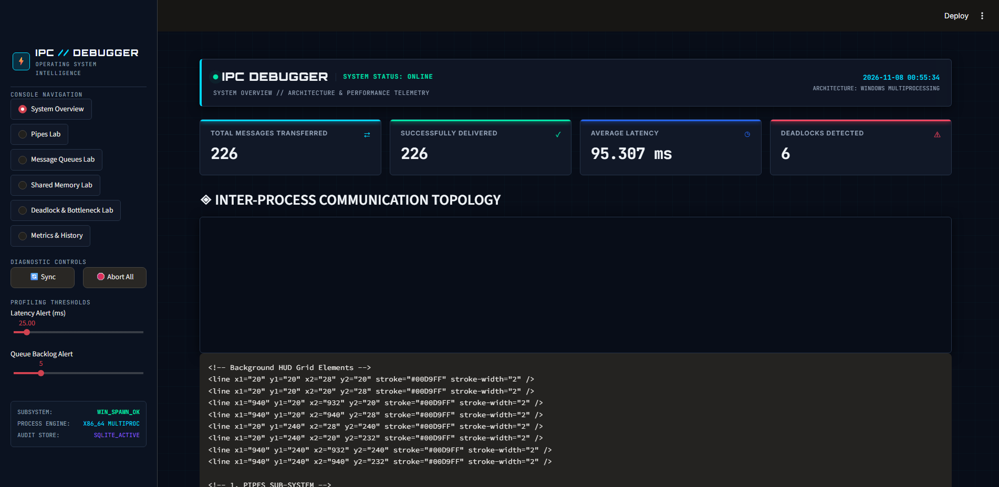
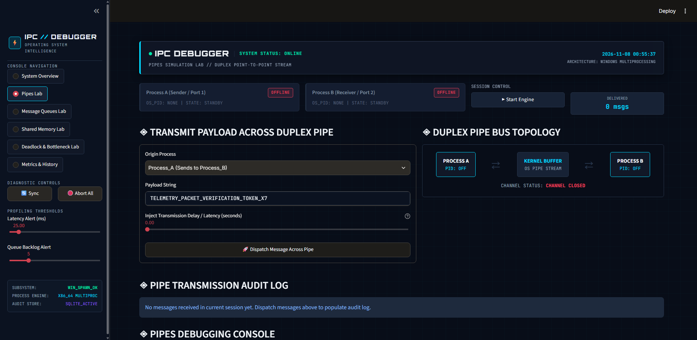
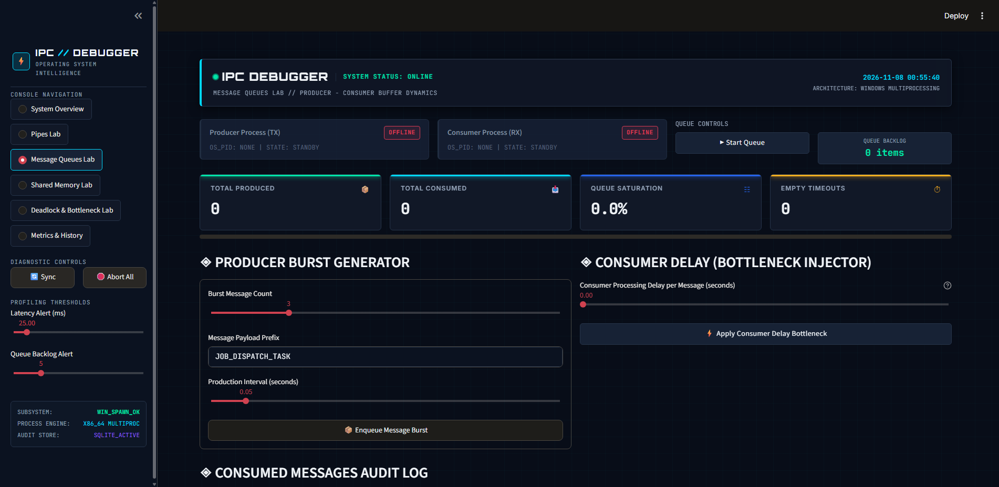
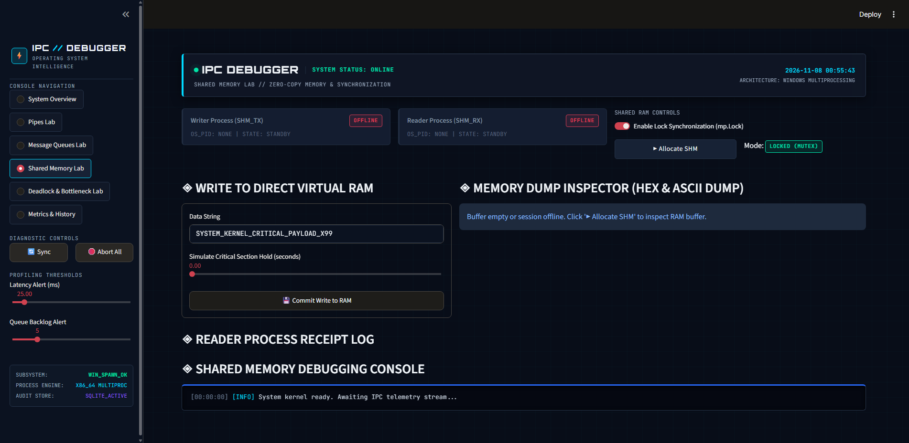
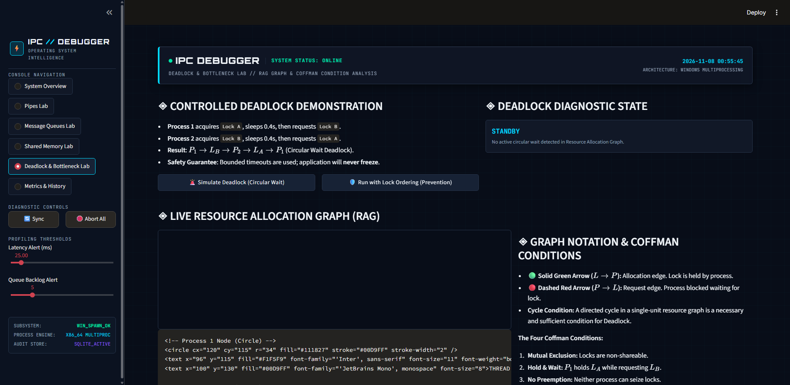
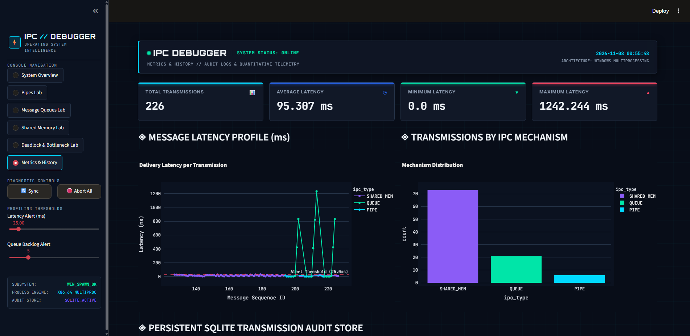

# ⚡ IPC Debugger: Inter-Process Communication Debugging & Visualization Tool
**College-Level Operating Systems Capstone Project**  
*A real-time diagnostic profiler and interactive lab for OS-level Inter-Process Communication (Pipes, Message Queues, and Shared Memory) on Windows.*

---

## 📖 1. Project Overview & Problem Statement

Modern multiprogramming and distributed operating systems rely on Inter-Process Communication (IPC) mechanisms to enable independent processes with separate address spaces to exchange data, coordinate tasks, and synchronize access to shared resources. However, developers frequently encounter complex failure modes:
- **Synchronization Hazards**: Race conditions, dirty reads, and torn writes in unsynchronized shared memory.
- **Deadlocks**: Circular wait conditions arising from un-ordered lock acquisition (the Four Coffman Conditions).
- **Communication Bottlenecks**: Producer-consumer throughput imbalances, message queue backpressure, and extreme latency spikes.
- **Starvation & Timeouts**: Blocking reads on empty pipes/queues leading to thread/process starvation.

**IPC Debugger** provides a comprehensive, interactive, web-based diagnostic environment. It creates actual operating system processes (via Python's `multiprocessing` library), establishes real communication channels, captures real-time kernel-level telemetry, and renders analytical dashboards, Resource Allocation Graphs (RAG), and event logs.

---

## 🏗️ 2. System Architecture

```
                                 +-------------------------------------+
                                 |         Streamlit Dashboard         |
                                 |   (Dark Cyber GUI & Visualizer)     |
                                 +------------------+------------------+
                                                    |
                       +----------------------------+----------------------------+
                       |                                                         |
         +-------------v-------------+                             +-------------v-------------+
         |     IPC Engine Core       |                             |   Diagnostics & Telemetry |
         +---------------------------+                             +---------------------------+
         | - pipe_handler.py         |                             | - bottleneck_detector.py  |
         | - queue_handler.py        |                             | - deadlock_detector.py    |
         | - shared_memory_handler.py|                             | - synchronization.py      |
         +-------------+-------------+                             | - event_logger.py         |
                       |                                           +-------------+-------------+
                       |                                                         |
         +-------------v-------------+                             +-------------v-------------+
         |  OS Process Subsystem     |                             |  Persistent Audit Store   |
         +---------------------------+                             +---------------------------+
         | - Windows Process Spawner |                             | - SQLite (db_manager.py)  |
         | - psutil Telemetry Monitor|                             | - Real-time In-memory Deq |
         +---------------------------+                             +---------------------------+
```

### Process Communication Topology
```
[1. Duplex Pipe]
Process A (PID 1) <=========[ multiprocessing.Pipe() ]=========> Process B (PID 2)
  - Full-duplex kernel byte-stream connection
  - Bounded latency measurement ($T_{recv} - T_{send}$)

[2. Message Queue]
Producer (PID 3) ---------> [ multiprocessing.Queue() ] ---------> Consumer (PID 4)
                            (FIFO Bounded Buffer)
  - Backlog meter: Messages Sent - Messages Consumed
  - Detection of empty queue timeouts and queue saturation backpressure

[3. Shared Memory]
Writer Process (PID 5) -----\                               /-----> Reader Process (PID 6)
                             \                             /
                              ===> [ Direct RAM Buffer ] <===
                             /      /shm_xxxx (4096 B)     \
              mp.Lock (Guard)                               mp.Lock (Guard)
  - Synchronized Mode: Guarded atomic access via multiprocessing.Lock
  - Unsynchronized Mode: Demonstrates torn writes and memory corruption
```

---

## 🔬 3. Deep-Dive: The Three IPC Mechanisms

| Mechanism | Kernel Architecture | Data Movement | Synchronization Mode | Typical Bottlenecks / Pitfalls |
| :--- | :--- | :--- | :--- | :--- |
| **Pipes** (`multiprocessing.Pipe`) | Unidirectional or duplex kernel-level byte stream buffer. | Message is serialized (pickled), copied into kernel space, then copied into user space of the receiver. | Implicit synchronization: `conn.recv()` blocks until data arrives or channel is closed. Polling via `poll(timeout)`. | Broken pipe (`EPIPE`), blocking I/O hang, serialization overhead with large arrays. |
| **Message Queues** (`multiprocessing.Queue`) | Pipe-based FIFO queue backed by a background feeder thread and semaphore synchronization. | Multiple producers and consumers push/pull discrete message packets. | Built-in thread-safe & process-safe locks. Non-blocking and bounded timeout operations (`put(timeout)`, `get(timeout)`). | Queue saturation / backpressure when consumer is slower than producer; consumer starvation when empty. |
| **Shared Memory** (`shared_memory.SharedMemory`) | Direct memory mapping (`CreateFileMapping` / `OpenFileMapping` on Windows; POSIX `shm_open` on UNIX). | **Zero-Copy**: Both processes map the exact same physical RAM pages into their virtual address spaces. | **Explicit**: OS provides no synchronization! Must use `multiprocessing.Lock` or semaphores. | Race conditions, dirty reads, torn writes, lock contention, deadlock. |

---

## 🔒 4. Deadlock Analysis & Graph-Theoretic Cycle Detection

### The Four Coffman Conditions
A deadlock can occur if and only if all four conditions hold simultaneously:
1. **Mutual Exclusion**: Resources (locks) cannot be shared simultaneously.
2. **Hold and Wait**: A process holds one lock while waiting to acquire another.
3. **No Preemption**: Locks cannot be forcibly confiscated from a process.
4. **Circular Wait**: Process 1 waits for Lock B (held by Process 2), while Process 2 waits for Lock A (held by Process 1).

### Controlled Demonstration
The **Deadlock Lab** implements a controlled two-process, two-lock scenario:
- **Process 1**: Acquires `Lock A`, sleeps 0.4s, then attempts to acquire `Lock B`.
- **Process 2** (*Deadlock Mode*): Acquires `Lock B`, sleeps 0.4s, then attempts to acquire `Lock A`.
- **Resulting Cycle**: `Process_1 -> Lock_B -> Process_2 -> Lock_A -> Process_1`.

### Detection Algorithm (Resource Allocation Graph)
The system maintains a directed bipartite graph $G = (V, E)$ where $V = P \cup L$ (Processes and Locks):
- **Allocation Edge**: $L \to P$ indicating Lock $L$ is currently held by Process $P$.
- **Request Edge**: $P \to L$ indicating Process $P$ is blocked requesting Lock $L$.
- A Depth-First Search (DFS) with a recursion stack identifies directed cycles in $O(V + E)$ time.

### Prevention via Total Lock Ordering (Dijkstra's Hierarchy)
In **Prevention Mode**, all processes acquire locks according to a global order:
$$\text{Lock A} < \text{Lock B}$$
Both Process 1 and Process 2 request Lock A first, then Lock B. Because circular wait is mathematically impossible under total ordering, deadlock is provably prevented.

### Safety Guarantee
All lock acquisitions use bounded timeouts (`timeout=3.5s`). If a cycle is formed, the detector flags the circular wait, and when the timeout fires, both processes cleanly release all resources, ensuring the application **never hangs**.

---

## 🚨 5. Bottleneck Analysis & Detection Criteria

The `BottleneckDetector` evaluates real-time metrics against configurable thresholds:
1. **Transmission Latency Threshold**:
   - Flagged when message transfer latency ($T_{recv} - T_{send}$) exceeds baseline (default: $25.0\text{ ms}$).
   - Catches OS CPU scheduling jitter, process priority inversion, and serialization overhead.
2. **Queue Saturation & Backlog**:
   - Flagged when unconsumed backlog exceeds threshold (default: $5\text{ messages}$) or capacity exceeds $75\%$.
   - Identifies producer-consumer throughput imbalance.
3. **Consumer Starvation**:
   - Flagged when idle timeout counter exceeds threshold (default: 3 timeouts).
4. **Lock Contention**:
   - Flagged when lock acquisition wait time exceeds $50.0\text{ ms}$.

---

## 💻 6. Project Structure

```
ipc-debugger/
├── app.py                      # Main Streamlit dashboard application
├── requirements.txt            # Python dependencies
├── ipc/
│   ├── __init__.py
│   ├── pipe_handler.py         # Duplex Pipe session manager & worker loops
│   ├── queue_handler.py        # Producer-Consumer queue manager & backpressure handler
│   └── shared_memory_handler.py# SharedMemory allocator, lock synchronization, & hex viewer
├── debugging/
│   ├── __init__.py
│   ├── synchronization.py      # MonitoredLock & telemetry tracker
│   ├── bottleneck_detector.py  # Latency, backlog, and contention analyzer
│   ├── deadlock_detector.py    # Resource Allocation Graph (RAG) & cycle detector
│   └── event_logger.py         # Real-time and persistent SQLite event logger
├── utils/
│   ├── __init__.py
│   └── process_manager.py      # Process lifecycle, psutil OS inspection, & cleanup
├── database/
│   ├── __init__.py
│   └── db_manager.py           # SQLite persistence layer for messages & audit events
├── tests/
│   ├── __init__.py
│   ├── test_app.py             # UI compilation & sanity tests
│   ├── test_pipe.py            # Pipe lifecycle & bidirectional transfer tests
│   ├── test_queue.py           # Queue backlog & producer-consumer tests
│   ├── test_shared_memory.py   # Synchronized vs unsynchronized SHM tests
│   ├── test_deadlock.py        # RAG cycle detection & timeout resolution tests
│   └── test_bottleneck.py      # Latency & backlog threshold tests
├── assets/                     # Live application screenshots and figures
│   ├── dashboard_overview.png
│   ├── pipes_lab.png
│   ├── queues_lab.png
│   ├── shared_memory_lab.png
│   ├── deadlock_lab.png
│   └── metrics_history.png
├── scripts/
│   └── capture_screenshot.py   # Headless browser automated screenshot capture script
└── README.md                   # Comprehensive project documentation
```

---

## 🖼️ 7. Screenshots of the Working Application

### System Overview & Architecture


### Pipes Simulation Lab


### Message Queues Lab (Producer - Consumer)


### Shared Memory & Synchronization Lab


### Deadlock & Bottleneck Lab (Resource Allocation Graph)


### Performance Metrics & SQLite Audit History


---

## ⚡ 8. Installation & Execution Guide

### Prerequisites
- Python 3.10+ (Tested on Python 3.12 on Windows)
- Modern web browser (Chrome, Edge, Firefox)

### Step 1: Clone or Navigate to Project
```bash
cd d:\OS_PROJECT
```

### Step 2: Install Dependencies
```bash
pip install -r requirements.txt
```

### Step 3: Run the Test Suite
Verify that all 17 unit and integration tests pass cleanly:
```bash
python -m pytest tests -v
```

### Step 4: Launch the Streamlit Dashboard
```bash
python -m streamlit run app.py
```
Open your browser at `http://localhost:8501`.

---

## 🧪 9. Test Cases & Verification Results

All tests execute actual multiprocessing calls on Windows:

```
============================= test session starts =============================
platform win32 -- Python 3.12.3, pytest-9.2.0, pluggy-1.7.0
rootdir: D:\OS_PROJECT
collected 17 items

tests/test_app.py::test_app_compiles PASSED                              [  5%]
tests/test_app.py::test_app_required_views_and_handlers PASSED           [ 11%]
tests/test_bottleneck.py::test_latency_bottleneck_detection PASSED       [ 17%]
tests/test_bottleneck.py::test_queue_backlog_bottleneck_detection PASSED [ 23%]
tests/test_bottleneck.py::test_lock_wait_bottleneck_detection PASSED     [ 29%]
tests/test_deadlock.py::test_rag_cycle_detection PASSED                  [ 35%]
tests/test_deadlock.py::test_deadlock_simulation_with_timeout_resolution PASSED [ 41%]
tests/test_deadlock.py::test_deadlock_prevention_ordered_locks PASSED    [ 47%]
tests/test_pipe.py::test_pipe_start_and_process_lifecycle PASSED         [ 52%]
tests/test_pipe.py::test_pipe_message_transfer PASSED                    [ 58%]
tests/test_pipe.py::test_pipe_bidirectional_transfer PASSED              [ 64%]
tests/test_queue.py::test_queue_lifecycle PASSED                         [ 70%]
tests/test_queue.py::test_queue_multiple_messages PASSED                 [ 76%]
tests/test_queue.py::test_queue_backlog_detection PASSED                 [ 82%]
tests/test_shared_memory.py::test_shared_memory_lifecycle PASSED         [ 88%]
tests/test_shared_memory.py::test_shared_memory_synchronized_write_read PASSED [ 94%]
tests/test_shared_memory.py::test_shared_memory_unsynchronized_mode PASSED [100%]

============================= 17 passed in 12.42s =============================
```

---

## 🪟 10. Windows Multiprocessing Compatibility Notes

Operating systems differ fundamentally in process creation:
- **POSIX (Linux/macOS)**: Uses `fork()`, which duplicates the parent's memory pages using copy-on-write.
- **Windows**: Uses `spawn` mode exclusively. The operating system creates a fresh Python interpreter instance and re-imports the main execution entry points.

To achieve flawless operation on Windows:
1. **Module-level Worker Targets**: All process target functions (`pipe_worker_a`, `queue_producer_worker`, `shm_writer_worker`, etc.) are declared at the top-level of their respective modules rather than as nested functions or lambdas.
2. **Safe Resource Unlinking**: `multiprocessing.shared_memory.SharedMemory` handles are closed (`close()`) by both the reader and writer processes before `unlink()` is invoked by the managing session, avoiding Windows `PermissionError` and file locks.
3. **Bounded Timeouts**: All pipe pollings, queue get/puts, and lock acquisitions utilize bounded timeouts (`poll(0.05)`, `queue.get(timeout=0.2)`, `lock.acquire(timeout=3.5)`), guaranteeing that the Streamlit GUI thread is never blocked.
4. **Clean Process Lifecycle**: The `ProcessManager` and session cleanup hooks explicitly call `.join(timeout=1.0)` followed by `.terminate()` and `.kill()` to guarantee no orphan processes remain running.

---

## 🚀 11. Known Limitations & Future Scope

### Known Limitations
1. **Single-Node Execution**: Current IPC mechanisms rely on local OS kernel primitives (`multiprocessing`), limiting communication to processes residing on the same host machine.
2. **Pickling Overhead**: Python's `multiprocessing.Pipe` and `Queue` pickle arbitrary objects, which introduces CPU overhead for very large complex data structures (though Shared Memory bypasses this with raw binary buffers).
3. **Fixed Shared Memory Sizing**: The shared memory segment is allocated with a fixed block size (e.g. 4096 bytes) and does not automatically dynamically resize at runtime.

### Future Scope
1. **Distributed Network IPC**: Extend the debugger to profile Network Sockets (TCP/UDP), Unix Domain Sockets, and Remote Procedure Calls (gRPC).
2. **Lock-Free Ring Buffers**: Implement single-producer single-consumer (SPSC) lock-free ring buffers over shared memory using atomic memory barriers.
3. **POSIX Semaphore & Message Queue Adapters**: Provide cross-platform POSIX `mq_open` and `sys/sem.h` C-extensions for Linux-specific kernel tracing.
4. **eBPF Kernel Probing**: Integrate eBPF or Windows ETW (Event Tracing for Windows) to capture system-call latency directly at the kernel syscall boundary (`NtReadFile`, `NtWriteFile`, `MapViewOfSection`).

---

## 📜 License & Academic Integrity
Developed as a college-level Operating Systems project demonstrating process management, synchronization primitives, and IPC architectures.
